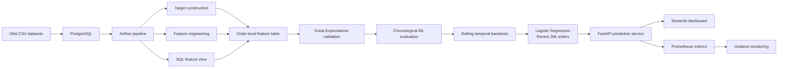

# Olist Delivery Risk Prediction Platform

End-to-end machine learning system for predicting late-delivery risk in Brazilian e-commerce orders.

The project combines data engineering, data-quality validation, time-aware machine learning, API serving, business analytics, and operational monitoring.

## Overview

The objective is to estimate, at or shortly after order approval, the probability that an order will be delivered after its estimated delivery date.

The project uses the public Olist Brazilian E-Commerce dataset and builds an order-level modeling dataset from multiple relational tables including orders, customers, sellers, products, order items, payments, and geolocation.

The final modeling dataset contains **96,470 delivered orders**.

Late delivery is defined as:

```text
actual customer delivery date > estimated delivery date
```

The overall late-delivery rate is approximately **8.1%**, making this an imbalanced classification problem.

## Architecture



## Tech Stack

**Data & ML**

* Python
* pandas
* NumPy
* scikit-learn
* SQLAlchemy
* PostgreSQL

**Data Engineering**

* Apache Airflow
* Docker
* Great Expectations

**Serving & Applications**

* FastAPI
* Streamlit

**Monitoring**

* Prometheus
* Grafana

**Engineering**

* pytest
* Git
* Docker Compose

## Data Pipeline

The raw Olist dataset contains multiple relational tables.

The pipeline:

1. Loads raw CSV files into PostgreSQL.
2. Builds the late-delivery target.
3. Aggregates one-to-many tables before joining to maintain one row per order.
4. Generates product, seller, payment, temporal, and geographic features.
5. Computes customer-seller geographic distance using ZIP-level median coordinates and the Haversine formula.
6. Runs automated feature validation with Great Expectations.
7. Produces the final modeling table used by the ML pipeline.

The final feature table contains:

```text
96,470 orders
32 columns
0 duplicate order IDs
```

Great Expectations validates constraints including:

* unique and non-null order IDs
* binary and non-null target
* non-negative monetary values
* valid item counts
* valid geographic distances
* expected dataset size

The final validation suite currently passes all configured expectations.

## Feature Engineering

Examples of model inputs include:

* estimated delivery window
* purchase month, weekday, and hour
* approval delay
* customer city and state
* number of items
* number of unique products
* number of sellers
* product price statistics
* freight cost
* product weight and volume
* seller state
* product category
* payment information
* customer-seller same-state indicator
* customer-seller distance

Only information available at or shortly after order approval is used for prediction.

Post-outcome variables such as actual delivery date, customer reviews, and final order status are excluded from model inputs.

## Exploratory Findings

Late-delivery rates vary substantially across geography and time.

Examples from the dataset include:

```text
Cross-state late rate: 9.26%
Same-state late rate:  6.06%
```

Average customer-seller distance:

```text
On-time orders: ~588 km
Late orders:    ~739 km
```

The strongest challenge, however, is temporal instability.

Monthly late-delivery rates vary considerably, for example:

```text
2017-11: 14.31%
2018-02: 15.99%
2018-03: 21.36%
2018-06:  1.36%
2018-07:  4.48%
2018-08: 10.39%
```

This makes random train/test splitting inappropriate for evaluating future deployment performance.

## Time-Aware Evaluation

Orders are sorted chronologically.

The initial evaluation used:

```text
Oldest 80% -> development data
Newest 20% -> future holdout
```

Development set:

```text
77,176 orders
late-delivery rate: 8.82%
```

Future period:

```text
19,294 orders
late-delivery rate: 5.29%
```

The large prevalence shift provides evidence of temporal distribution drift.

## Model V1

Initial model comparison used time-series cross-validation.

Random Forest and Logistic Regression both substantially outperformed a dummy baseline during development.

A tuned Random Forest obtained approximately:

```text
CV Average Precision: 0.189
```

However, evaluation on the later period revealed severe degradation:

```text
Average Precision: 0.0587
ROC-AUC:          0.4701
Mean prediction: 43.10%
Actual late rate: 5.29%
```

This exposed an important deployment issue that would have been obscured by a conventional random split.

## Temporal Drift Investigation

Rolling temporal backtests were used to compare:

* expanding training windows
* latest 40,000 orders
* latest 20,000 orders

Models included:

* Logistic Regression
* Balanced Logistic Regression
* Random Forest
* Balanced Random Forest
* Extra Trees

The best recent-window configuration was **Logistic Regression trained on the latest 20,000 development orders**.

Across recency backtests:

```text
Mean Average Precision: 0.268
Mean ROC-AUC:           0.716
Mean Brier score:       0.102
```

Average validation prevalence:

```text
Actual late rate:       12.35%
Mean predicted rate:    10.23%
```

The recent-window strategy outperformed expanding-window variants and showed better probability calibration.

## Model V2

The final candidate uses:

```text
Model: Logistic Regression
Training window: latest 20,000 development orders
Class weighting: none
```

Threshold selection was performed only within development data.

On the later post-hoc future period:

```text
Average Precision: 0.0938
ROC-AUC:          0.6478
Brier score:      0.0505

Actual late rate:       5.29%
Mean predicted rate:    2.77%
```

Compared with Model V1, the new strategy substantially improves ranking performance and probability calibration under temporal drift.

The binary classification threshold is intentionally treated as secondary because threshold performance is not stable across periods with changing late-delivery prevalence.

## API

The trained model is exposed through FastAPI.

Endpoints include:

```text
GET  /
GET  /health
POST /predict
GET  /metrics/
```

Example prediction response:

```json
{
  "late_delivery_probability": 0.12,
  "prediction": 0,
  "risk": "lower",
  "threshold": 0.2266
}
```

The probability score should be interpreted as the primary model output.

## Streamlit Dashboard

The Streamlit application provides:

* total order volume
* historical late-delivery rate
* geographic breakdowns
* monthly trends
* same-state vs cross-state analysis
* numerical delivery profiles
* interactive single-order prediction

Run locally with:

```bash
python -m streamlit run dashboard/app.py
```

## Monitoring

FastAPI exposes Prometheus metrics for:

* request volume
* request latency
* HTTP error rate
* prediction volume
* high-risk prediction rate
* prediction probability distribution

Prometheus scrapes the API and Grafana provides operational dashboards.

This separates:

```text
Streamlit -> business analytics

Grafana -> service monitoring
```

## Automated Tests

The project includes pytest coverage for:

* model loading
* feature count
* prediction probability bounds
* binary prediction
* risk labels
* API health endpoint
* prediction endpoint
* invalid API input

Run:

```bash
python -m pytest -v
```

## Running the Project

### Environment

```bash
python -m venv .venv
source .venv/bin/activate
pip install -r requirements.txt
```

### PostgreSQL

```bash
docker compose up -d
```

### Airflow

```bash
docker compose -f docker-compose.airflow.yml up -d
```

### FastAPI

```bash
python -m fastapi dev src/api.py
```

### Streamlit

```bash
python -m streamlit run dashboard/app.py
```

### Prometheus + Grafana

```bash
docker compose -f docker-compose.monitoring.yml up -d
```

## Repository Structure

```text
olist-delivery-risk/
├── airflow/
│   └── dags/
├── dashboard/
├── data/
│   ├── raw/
│   └── processed/
├── great_expectations/
├── models/
├── monitoring/
│   ├── grafana/
│   └── prometheus/
├── reports/
├── sql/
├── src/
├── tests/
├── docker-compose.yml
├── docker-compose.airflow.yml
├── docker-compose.monitoring.yml
├── Dockerfile.airflow
├── requirements.txt
└── README.md
```

## Key Engineering Lessons

The main lesson from this project is that strong cross-validation performance does not guarantee future robustness.

A conventional random split could have produced optimistic metrics. Chronological evaluation instead exposed:

* changing class prevalence
* temporal performance degradation
* poor probability calibration
* threshold instability

Rolling temporal validation and recent-window training produced a more realistic deployment strategy.

## Limitations

* The target is defined only for orders that were eventually delivered, so cancellation and non-delivery are outside the model scope.
* Multi-seller orders are simplified using a primary seller representation.
* Historical Olist data represents a fixed period and may not reflect modern e-commerce operations.
* Temporal drift remains significant.
* Binary decision thresholds require monitoring and periodic recalibration.
* Model probability calibration should be continuously monitored in a real production environment.

## Future Improvements

Potential extensions include:

* automated drift detection
* scheduled model retraining
* probability recalibration
* richer rolling-window model selection
* LightGBM or XGBoost comparison
* feature-store integration
* prediction logging
* automated Grafana alerts
* CI/CD pipeline
* containerized API deployment
